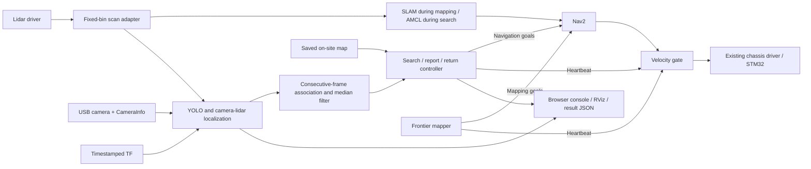

# EE3033 Final Project — Group 4

ROS 2 software for a balancing car to construct an on-site map, search for a target,
report its `(x, y)` position in the `map` frame, and return to its recorded start.
The default test target is **cup**. A Pepsi can must first be checked against the
installed model: a COCO class detector does not identify a Pepsi brand or a
specific instance among several cups.

## Features

- Autonomous frontier mapping with conservative reachable goals, navigation via
  Nav2, return to mapping start, and a new directory for every map save.
- Saved-map AMCL localization and map-derived camera viewpoints for systematic
  search. The assessment map and target coordinates are never hard-coded.
- YOLO detection, timestamped camera/lidar association, and transformation into
  map coordinates. An explicitly selected ground-plane projection is available
  for targets whose bottom rests on the floor.
- Four extra features: consecutive-frame target confirmation with spatial
  association; robust coordinate filtering; mission/status visualization; and
  distance plus stationary-odometry verification at home.
- Browser operator console with live map, annotated video, state, target
  coordinates/confidence, coverage, event log, initial pose setup, and Start/Stop.
- Stage-1 mapping waypoints with click-drag position and final facing, safe
  approaches toward unexplored areas, and independent arrival verification.
- One final velocity gate with command, lidar, and mission-heartbeat deadlines.
  Manual control is restricted to the mapping stage. Motion defaults to disabled.
- Stopped-only narrow-gap blocking with verified global/local footprints,
  synchronized mapping/search clearance, rollback and fault lockout.
- Nav2 rotation shim aligns the car before driving along a new path; frontier
  scoring penalizes unnecessary turns and avoids very close goals.

## Deployment and dependencies

The supported robot runtime is **ROS 2 Humble in the existing `ros2_humble`
container**, with the lab workspace at `/home/ros2_ws`. Its installed packages
`balance_robot_base`, `balance_usb_cam`, and `lslidar_driver_n10p` are reused.
Nav2, SLAM Toolbox, OpenCV/cv_bridge, NumPy, SciPy, PyTorch, and Ultralytics must
also be available. The existing YOLO weights are loaded from
`/home/ros2_ws/weights/yolo26n.pt`; weights are not stored in this repository.

No original lab program, PID value, or existing map is modified by this package.
Hardware launches explicitly use the installed base driver's `base_params.yaml`
inside a scoped launch group. The mission's project `config` cannot override the
base's frame IDs or settings, and hardware arguments cannot replace the project
configuration used by perception and mission nodes.
Build it in a separate overlay:

```bash
# Inside the robot's ros2_humble container; adjust the checkout path if needed.
cd /home/ros2_ws/group4_project
bash scripts/build_robot.sh
source /home/ros2_ws/group4_ws/install/setup.bash
export ROS_DOMAIN_ID=6
export RMW_IMPLEMENTATION=rmw_fastrtps_cpp
bash scripts/check_environment.sh
```

Stop earlier navigation/follower bringups before starting this stack. Do not run
two base drivers, lidar drivers, or velocity writers simultaneously. If a sensor
driver is deliberately reused, pass `base:=false`, `lidar:=false`, or
`camera:=false` as appropriate. Do not reuse an earlier `/scan_fixed` publisher
alongside this package's resampler.

## Recommended: one console for the basic briefing workflow

The assessment console reuses the existing `mapping.launch.py` and
`mission.launch.py` stacks. It adds an operator workflow around the already
implemented mapper, Nav2, AMCL, detector, filter and velocity gate; it does not
replace the original robot drivers, lab files, saved maps or balance PID.

Inside Humble, source the lab and project overlays, then launch:

```bash
ros2 launch ee3033_project assessment.launch.py allow_motion:=true \
  map_directory:=/home/ros2_ws/group4_maps \
  session_directory:=/home/ros2_ws/group4_results/assessment
```

Without `allow_motion:=true`, the console can load services but rejects motion
starts. The console initially starts no hardware. Open
`http://127.0.0.1:8765` through SSH forwarding and use this sequence:

The sidebar (or mobile tabs) separates **Overview**, **Mapping**, **Mission**,
**Navigation settings**, and **Results**. Direct links such as `/#/mapping` open
the corresponding page. Stop, connection, battery and stage readiness remain
available across pages; the live map appears on Overview, Mapping and Mission.

1. On **Mapping**, **Load mapping** with the target absent. The combined timer starts here,
   because SLAM is constructing the map even before the first motion command.
2. **Start automatic mapping**, use **Go & map** waypoints, or permitted hold-to-drive controls while
   automatic mapping is inactive. **Stop robot** cancels and disables motion.
3. Save a new map if needed, inspect accessible and missing areas, select it and
   **Mark map reviewed**. Review changes metadata only; a partial map stays
   labelled partial. Original map pixels and YAML remain unchanged.
4. On **Mission**, after the target is placed, select the detector class, a validated coordinate
   method and the examiner's return tolerance. **Load selected map for mission**
   stops the owned mapping launch, verifies its processes and ROS publishers
   have disappeared, then starts saved-map localization and the mission stack.
   It waits for Start. Only a reviewed map saved during this trial is accepted.
5. Establish the assigned **initial pose** in the loaded map. Drag from position
   toward heading, or enter that start pose. **Start autonomous mission** records
   home and begins the existing search → report → return → stationary-stop logic.
6. On **Results**, read target `(x, y)` in metres in `map`, the return distance/tolerance and the
   stationary verification. **Download trial JSON** exports the record without
   console tokens. **New trial** stops the idle owned stage and loads fresh SLAM;
   earlier maps and trial directories are preserved.

Stage 2 has no manual driving, navigation goals, map edits or target-coordinate
entry. Setup and stage changes are rejected while active; initial-pose changes
are locked after mission Start. Stop bypasses stage and parameter transactions.
Commands queued before a stage change or Stop carry an obsolete control
context and are rejected. Crashed nodes are reported and never auto-restarted;
follow the examiner's intervention procedure before any manual reload.

The continuous monotonic timer spans mapping, review, localization, mission and
interventions. It survives a console restart in the same host boot. A reboot
marks timing interrupted instead of inventing an elapsed time. Only a confirmed
target and the mission's explicit verified return can finish a successful timer.
A mission started from the standalone legacy launch is labelled search-only if
its record did not include mapping.

Use `base:=false`, `lidar:=false`, or `camera:=false` at assessment launch only
when deliberately reusing an existing corresponding driver. The console rejects
an initial load that would duplicate known drivers or another project stack.
Keep exactly one scan adapter and one final velocity writer. Stage changes
restart only the stage launches owned by this console.

To inspect the new UI without ROS or hardware:

```bash
python3 scripts/preview_ui.py
# http://127.0.0.1:8790 — explicitly simulated, read-only; POST controls reject
```

The standalone stage launch procedures below remain available.

The target selector reads `model.names` from the configured detection weights,
without a hard-coded list or free-text target entry. An isolated bounded process
reads the metadata so the console does not retain another Torch model. Metadata
is cached until the weight file changes; missing/unreadable weights leave mission
setup disabled. The server rejects labels outside that model, and Perception
checks the selected class again when it loads the weights. Standard YOLO26n uses
[COCO labels](https://github.com/ultralytics/ultralytics/blob/main/ultralytics/cfg/datasets/coco.yaml)
such as cup, bottle, bowl, book and chair; it has no Pepsi brand label.
Inspect actual detections before choosing the assessment target class.

## Stage 1 — construct a new map

```bash
ros2 launch ee3033_project mapping.launch.py allow_motion:=true \
  map_directory:=/home/ros2_ws/group4_maps
```

Open the operator console, then select **Start automatic mapping**. The robot
chooses reachable frontiers, returns to the mapping start, and saves a new map.
`MAPPED` means no sufficiently large frontier remains; `MAPPED_PARTIAL` means
some frontier could not be approached or a time/return limit occurred. Inspect
the resulting map before the autonomous search. Manual mapping is also available
through the hold-to-drive controls when automatic mapping is inactive and the
examiner permits it. Releasing the button or losing the browser stops manual
commands within the deadman timeout.

For **Waypoint mapping**, stop automatic mapping, then drag on the Mapping
page's map from the desired position toward the final facing. Alternatively,
enter waypoint x/y in metres and facing in degrees. The arrow previews the goal;
**Go & map** starts it. A point in unknown space is approached via reachable
mapped-free frontiers biased toward that point while SLAM continues updating.
The robot never receives a driving goal in unknown or occupied space. Once the
chosen point becomes reachable, navigation reaches it and Nav2 Spin establishes
the requested facing. Fresh pose and stationary odometry must confirm position
within 0.20 m and heading within 0.15 rad before `WAYPOINT_REACHED` is reported.
SLAM remains live and the car stays there; save a map explicitly when finished.

Occupied/outside-map goals are rejected. No mapped approach, sensor faults,
unverified arrival and action timeouts stop the attempt. Stop also invalidates
an older queued waypoint request, including late turn acceptance. Position and
facing controls are confined to stage 1; mission-stage map dragging only sets
the assigned localization pose before autonomous Start.

To save another snapshot without overwriting any map, use **Save a new map** or:

```bash
bash scripts/save_map.sh /home/ros2_ws/group4_maps
```

The **Mapping trial settings** panel displays live forward/turn speed caps and
the per-goal timeout. Stop mapping, adjust the sliders, then select **Apply trial
settings**. The console updates the gate, Nav2 controller, and mapper, verifies
their readback, and attempts rollback if a node rejects an update. Unverified
rollback locks console driving until a successful reapply. Bounds are
0.04–0.18 m/s, 0.15–0.60 rad/s, and 20–120 s. These settings are temporary until
restart; they do not alter balance PID, obstacle clearances, or lab files.

The **Audacity level** panel sets the planning reserve for automatic mapping
and mission navigation. **Cautious** is the original behaviour and remains the
default. Configure a level while mapping is idle or before mission Start.

| Level | Centre-to-boundary clearance | Nominal opening, gap blocking OFF | Turn stop |
|---|---|---|---|
| 1 · Cautious | 0.22 m | 0.44 m | 0.16 m |
| 2 · Balanced | 0.18 m | 0.36 m | 0.15 m |
| 3 · Bold | 0.14 m | About 0.30 m, limited by the padded Nav2 footprint | 0.14 m |

The UI selects a level only after verifying live parameters. It displays each
level's clearance and opening including any enabled gap reserve, plus its turn
stop distance. Levels change the mapper/search reserve and turning policy;
the collision radius, speed caps, lidar mask and forward obstacle stop retain
their existing values.
In particular, Bold does not guarantee passage through a 0.28 m physical gap.
Occupied and unknown cells still bound reachable planning space.

Balanced and Bold reuse Nav2's installed `PoseProgressChecker`, counting heading
changes of 0.35/0.20 rad as progress alongside the existing 0.10 m translation
threshold. A motionless robot still fails after the 18 s progress allowance;
the existing mapping/mission goal deadlines also remain. Cautious sets the angle
threshold above pi, retaining the original translation-only progress rule.
Both higher levels ramp rotation from previous commands so weak angular velocity
feedback cannot repeatedly hold the requested speed near zero. Balanced uses
0.4 rad/s² acceleration and Bold 0.8 rad/s², under the existing angular speed
cap. Their path-heading sampling distances are 0.20/0.30 m to reduce sensitivity
to very short path bends. Nav2 continues to check the rotating footprint for
collisions. The gate applies the selected 0.16/0.15/0.14 m turn stop and rejects
changes while enabled; fresh sensors, heartbeats and command deadlines remain
required. The 0.14 m lower bound is the requested Bold setting and does not
mask or classify close echoes as robot parts.

The **Narrow-gap blocking** button is available in both stages. Configure it
while mapping is idle or before starting stage 2. ON selects a 0.18 m virtual
radius in both Nav2 costmaps, from the estimated 0.20 m body width and 0.08 m
reserve on each side. OFF retains the original 0.14 m collision radius. Both
include 0.01 m footprint padding. This is a route policy; it does not edit the
SLAM map, change the scan mask, or disable obstacle/deadman protection.

Padding, footprint discretization, and the 0.05 m grid affect passage rejection.
Gap blocking adds 0.04 m to the selected level's centre-to-boundary clearance:
0.26/0.22/0.18 m for Cautious/Balanced/Bold. Nominal combined openings are about
0.52/0.44/0.38 m with blocking ON. The UI shows these live values, which are
planning estimates rather than centimetre-accurate fit guarantees. Only lateral
2D clearance is considered;
objects outside the lidar plane may remain unseen. Physical body measurements
and passage trials remain required.

The console atomically changes each node, verifies committed readback across
nodes, and attempts rollback on any rejection. An unverified gap rollback locks
console driving independently of trial-slider faults; a successful gap reapply
is needed to clear it. Custom polygon footprints or disabled inflation are
rejected by this policy rather than silently treated as a circular footprint.
These settings reset to Cautious with gap blocking OFF when the stage reloads.
The legacy gap-only API preserves the currently selected level.

Mapping uses relaxed final heading because the lidar observes all directions;
mission search retains its observation heading. A failed exploration goal is
deferred while other reachable frontiers are explored. A timeout first disables
motion and waits for the action's terminal result. Once other options are
exhausted, deferred areas get one final retry pass, replanned against the latest
map with the same clearance checks. The UI shows reached/deferred goals and the
retry pass. Remaining failures produce a partial map; the overall mapping time
limit still applies. A home-return timeout saves a separate partial map after
confirmed cancellation. Stop, sensor faults and unconfirmed cancellation never
start a successor goal. No node is automatically restarted.
A map with no safe connected space is never counted as completed exploration.

The header shows measured battery voltage from `/power_voltage` (`Float32`).
Readings older than five seconds are marked stale. No battery percentage or
chemistry-dependent low-voltage threshold is inferred.

Record the resulting absolute YAML path. Stop the mapping launch with Ctrl+C
before starting saved-map localization. Do not run SLAM and AMCL together as
competing `map -> odom_combined` transform publishers.

## Stage 2 — autonomous target search and return

Place the car at its assigned starting area after the target is placed. Launch:

```bash
ros2 launch ee3033_project mission.launch.py \
  map:=/absolute/path/from/mapping/map.yaml \
  target_class:=cup allow_motion:=true
```

In the console, drag from the robot's assigned map position toward its heading,
then click **Set initial pose**. Alternatively use RViz's **2D Pose Estimate**.
This setup must be completed before the autonomous mission. Once the lidar,
odometry, AMCL, transform, and YOLO checks are ready, select **Start autonomous
mission**. The mission records the current localized pose as home; chooses its
own navigation goals; confirms and reports the target; cancels search navigation;
returns home; and verifies its distance and stationary odometry before declaring
`COMPLETE`.

No target detected is reported as `NOT_FOUND` after returning, not as success.
`FAILED` or `STOPPED` disables the velocity gate. The controller does not
automatically restart failed nodes. During assessment, follow the examiner's
failure/intervention procedure before restarting or changing anything.

Start/Stop are also available as ROS services:

```bash
ros2 service call /project/start std_srvs/srv/Trigger '{}'
ros2 service call /project/stop std_srvs/srv/Trigger '{}'
ros2 topic echo /project/mission_result
```

The `allow_motion:=false` default is intended for bringup/bench inspection and
rejects mission starts. It is not a simulator.

## Operator console and RViz

The launch files start a loopback-only web server at `127.0.0.1:8765` **on the
robot**. From the computer, forward it over SSH:

```bash
ssh -N -L 8765:127.0.0.1:8765 balance@balance6.local
```

Open `http://127.0.0.1:8765` in the computer's browser. Authentication uses your
normal SSH login; no credentials belong in this repository. Initial pose changes,
manual driving, and map saving are enforced by the backend according to the
current stage/state, not merely hidden in the browser. There is no manual
navigation-goal control or manual target-coordinate entry.

For a second RViz/camera view on a computer with the package installed:

```bash
export ROS_DOMAIN_ID=6
ros2 launch ee3033_project view.launch.py
```

The browser console can also run on a computer with compatible ROS interfaces,
using `console.launch.py`; running the control backend inside Humble on the Pi
avoids cross-distribution ROS service incompatibilities.

## Architecture



Key interfaces:

| Topic / service | Type | Purpose |
|---|---|---|
| `/scan_fixed` | `sensor_msgs/LaserScan` | Fixed 450-bin scan |
| `/project/detection_image` | `sensor_msgs/Image` | Annotated YOLO video |
| `/project/target_observations` | `std_msgs/String` JSON | Per-image localized candidates, including misses |
| `/project/confirmed_target` | `geometry_msgs/PoseWithCovarianceStamped` | Confirmed target in map frame |
| `/project/target_details` | `std_msgs/String` JSON | Confidence, frame count, position variance |
| `/project/mission_status` | `std_msgs/String` JSON | State, coverage, failures, home and target |
| `/project/mission_result` | `std_msgs/String` JSON | Target report and terminal mission result |
| `/project/search_path` | `nav_msgs/Path` | Viewpoint order, not an obstacle-avoiding route |
| `/plan` | `nav_msgs/Path` | Nav2's actual planned path |
| `/project/markers` | `visualization_msgs/MarkerArray` | State, viewpoints, target and confidence |
| `/project/nav_cmd_vel` | `geometry_msgs/Twist` | Nav2 input to the gate |
| `/project/manual_cmd_vel` | `geometry_msgs/Twist` | Mapping-only manual input |
| `/cmd_vel` | `geometry_msgs/Twist` | Gated final chassis commands |
| `/project/start`, `/project/stop` | `std_srvs/Trigger` | Stage-specific start and stop |

Mission results are saved in a new `~/ee3033_results/mission_*` directory for
every run. Default console/automatic maps use `~/ee3033_maps/onsite_*` (inside
the container); choose a persistent bind-mounted location in configuration for
long-term storage. Generated results and maps are ignored by Git.

## Calibration and limitations to check before assessment

- Measure the footprint and mounting transforms. The starting values use
  `base_footprint`, `odom_combined`, `camera_link`, and `laser` from this car.
  The optical transform follows ROS optical axes; the lab driver remains the
  owner of the actual camera position and mounting pitch.
- The scan adapter masks returns inside the configured 0.14 m robot interior.
  Such rays become NaN (occluded/unknown), never clear-space rays. This was added
  after rear 0.04–0.07 m returns persisted when the car was moved to open space.
  Verify `self_mask_radius` against the actual scanner mounting and footprint;
  it must not mask valid obstacles outside the robot.
- Confirm CameraInfo matches 640×480 and the actual camera/lens. Camera tilt and
  balance-car pitch affect the accuracy of object position estimates.
- Default lidar localization requires the target to intersect the lidar plane,
  at least two compact returns inside its image box, and synchronized timestamps.
  A short can below the lidar, a transparent surface, or a wall behind it can
  make this association fail or be ambiguous. Check with known target positions.
- For an upright object resting on a known floor, explicitly select
  `localization_method:=ground_plane` only after validating camera calibration
  and floor height. No silent range guess is substituted for missing lidar data.
- Filtering suppresses jitter, not systematic calibration errors. The reported
  lidar position estimates the visible object surface, not a guaranteed geometric
  center. The configured uncertainty is a conservative engineering starting
  value, not an experimentally calibrated accuracy claim.
- Viewpoint coverage is an estimate of visible 2D free space, not proof every
  object was visually detectable. Occlusion, image resolution, lighting, target
  class, and unreachable areas remain practical limits.
- Set `return_tolerance` to the examiner's stated value. Final heading is ignored
  unless explicitly required. Only on-site assessment maps are used in the demo.

## Tests

Algorithm tests run without ROS:

```bash
pytest -q
```

After building the Humble overlay, run hardware-free integration tests on
isolated domains (never domain 6):

```bash
ROS_DOMAIN_ID=88 python3 tests/integration_ros.py
ROS_DOMAIN_ID=89 python3 tests/smoke_nav2.py
ROS_DOMAIN_ID=90 python3 tests/integration_console.py
ROS_DOMAIN_ID=93 python3 tests/integration_workflow.py
ROS_DOMAIN_ID=96 python3 tests/integration_mapping_retry.py
ROS_DOMAIN_ID=91 python3 tests/integration_gap_nav2.py
GROUP4_GAP_RESOLUTION=.05 ROS_DOMAIN_ID=92 python3 tests/integration_gap_nav2.py
```

The integration tests exercise actual ROS messages/actions, cancellation races,
sensor loss, obstacle/heartbeat velocity gating, false home success, unique map
saves, HTTP controls, and manual-control lockout. The Nav2 smoke test starts real
Nav2, AMCL, YOLO, and project nodes against synthetic sensors with motion
disabled. These tests do not replace physical navigation and calibration tests. The two-stage workflow integration
adds real process transitions, map saving/review, pose lockouts, timing and export
against synthetic ROS sensors/actions; fixtures refuse domain 6.

See [RUNBOOK.md](RUNBOOK.md) for stage transitions, combined timing, and report
evidence requirements. See [TESTING.md](TESTING.md) for the recorded results and remaining validation.

Optional browser checks use development-only dependencies (no Node.js is needed
on the robot). The default browser suite starts its own read-only simulated preview and
intercepts every test mutation. It does not require a running robot:

```bash
npm ci
npx playwright install chromium
npm run test:ui
```
