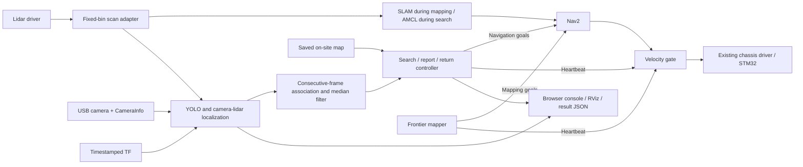

# EE3033 Final Project — Group 4

ROS 2 software for a balancing car to construct an on-site map, search for a target,
report its `(x, y)` position in the `map` frame, and return to its recorded start.
The default test target is **cup**. A Pepsi can must first be checked against the
installed model: a COCO class detector does not identify a Pepsi brand or a
specific instance among several cups.

## Features

- Autonomous frontier mapping with conservative reachable goals, navigation via
  Nav2, return to mapping start, and a new directory for every map save.
- Saved-map AMCL localization and map-derived camera viewpoints for systematic
  search. The assessment map and target coordinates are never hard-coded.
- YOLO detection, timestamped camera/lidar association, and transformation into
  map coordinates. An explicitly selected ground-plane projection is available
  for targets whose bottom rests on the floor.
- Four extra features: consecutive-frame target confirmation with spatial
  association; robust coordinate filtering; mission/status visualization; and
  distance plus stationary-odometry verification at home.
- Browser operator console with live map, annotated video, state, target
  coordinates/confidence, coverage, event log, initial pose setup, and Start/Stop.
- One final velocity gate with command, lidar, and mission-heartbeat deadlines.
  Manual control is restricted to the mapping stage. Motion defaults to disabled.
- Nav2 rotation shim aligns the car before driving along a new path; frontier
  scoring penalizes unnecessary turns and avoids very close goals.

## Deployment and dependencies

The supported robot runtime is **ROS 2 Humble in the existing `ros2_humble`
container**, with the lab workspace at `/home/ros2_ws`. Its installed packages
`balance_robot_base`, `balance_usb_cam`, and `lslidar_driver_n10p` are reused.
Nav2, SLAM Toolbox, OpenCV/cv_bridge, NumPy, SciPy, PyTorch, and Ultralytics must
also be available. The existing YOLO weights are loaded from
`/home/ros2_ws/weights/yolo26n.pt`; weights are not stored in this repository.

No original lab program, PID value, or existing map is modified by this package.
Build it in a separate overlay:

```bash
# Inside the robot's ros2_humble container; adjust the checkout path if needed.
cd /home/ros2_ws/group4_project
bash scripts/build_robot.sh
source /home/ros2_ws/group4_ws/install/setup.bash
export ROS_DOMAIN_ID=6
export RMW_IMPLEMENTATION=rmw_fastrtps_cpp
bash scripts/check_environment.sh
```

Stop earlier navigation/follower bringups before starting this stack. Do not run
two base drivers, lidar drivers, or velocity writers simultaneously. If a sensor
driver is deliberately reused, pass `base:=false`, `lidar:=false`, or
`camera:=false` as appropriate. Do not reuse an earlier `/scan_fixed` publisher
alongside this package's resampler.

## Stage 1 — construct a new map

```bash
ros2 launch ee3033_project mapping.launch.py allow_motion:=true
```

Open the operator console, then select **Start automatic mapping**. The robot
chooses reachable frontiers, returns to the mapping start, and saves a new map.
`MAPPED` means no sufficiently large frontier remains; `MAPPED_PARTIAL` means
some frontier could not be approached or a time/return limit occurred. Inspect
the resulting map before the autonomous search. Manual mapping is also available
through the hold-to-drive controls when automatic mapping is inactive and the
examiner permits it. Releasing the button or losing the browser stops manual
commands within the deadman timeout.

To save another snapshot without overwriting any map, use **Save a new map** or:

```bash
bash scripts/save_map.sh /home/ros2_ws/group4_maps
```

Record the resulting absolute YAML path. Stop the mapping launch with Ctrl+C
before starting saved-map localization. Do not run SLAM and AMCL together as
competing `map -> odom_combined` transform publishers.

## Stage 2 — autonomous target search and return

Place the car at its assigned starting area after the target is placed. Launch:

```bash
ros2 launch ee3033_project mission.launch.py \
  map:=/absolute/path/from/mapping/map.yaml \
  target_class:=cup allow_motion:=true
```

In the console, drag from the robot's assigned map position toward its heading,
then click **Set initial pose**. Alternatively use RViz's **2D Pose Estimate**.
This setup must be completed before the autonomous mission. Once the lidar,
odometry, AMCL, transform, and YOLO checks are ready, select **Start autonomous
mission**. The mission records the current localized pose as home; chooses its
own navigation goals; confirms and reports the target; cancels search navigation;
returns home; and verifies its distance and stationary odometry before declaring
`COMPLETE`.

No target detected is reported as `NOT_FOUND` after returning, not as success.
`FAILED` or `STOPPED` disables the velocity gate. The controller does not
automatically restart failed nodes. During assessment, follow the examiner's
failure/intervention procedure before restarting or changing anything.

Start/Stop are also available as ROS services:

```bash
ros2 service call /project/start std_srvs/srv/Trigger '{}'
ros2 service call /project/stop std_srvs/srv/Trigger '{}'
ros2 topic echo /project/mission_result
```

The `allow_motion:=false` default is intended for bringup/bench inspection and
rejects mission starts. It is not a simulator.

## Operator console and RViz

The launch files start a loopback-only web server at `127.0.0.1:8765` **on the
robot**. From the computer, forward it over SSH:

```bash
ssh -N -L 8765:127.0.0.1:8765 balance@balance6.local
```

Open `http://127.0.0.1:8765` in the computer's browser. Authentication uses your
normal SSH login; no credentials belong in this repository. Initial pose changes,
manual driving, and map saving are enforced by the backend according to the
current stage/state, not merely hidden in the browser. There is no manual
navigation-goal control or manual target-coordinate entry.

For a second RViz/camera view on a computer with the package installed:

```bash
export ROS_DOMAIN_ID=6
ros2 launch ee3033_project view.launch.py
```

The browser console can also run on a computer with compatible ROS interfaces,
using `console.launch.py`; running the control backend inside Humble on the Pi
avoids cross-distribution ROS service incompatibilities.

## Architecture



Key interfaces:

| Topic / service | Type | Purpose |
|---|---|---|
| `/scan_fixed` | `sensor_msgs/LaserScan` | Fixed 450-bin scan |
| `/project/detection_image` | `sensor_msgs/Image` | Annotated YOLO video |
| `/project/target_observations` | `std_msgs/String` JSON | Per-image localized candidates, including misses |
| `/project/confirmed_target` | `geometry_msgs/PoseWithCovarianceStamped` | Confirmed target in map frame |
| `/project/target_details` | `std_msgs/String` JSON | Confidence, frame count, position variance |
| `/project/mission_status` | `std_msgs/String` JSON | State, coverage, failures, home and target |
| `/project/mission_result` | `std_msgs/String` JSON | Target report and terminal mission result |
| `/project/search_path` | `nav_msgs/Path` | Viewpoint order, not an obstacle-avoiding route |
| `/plan` | `nav_msgs/Path` | Nav2's actual planned path |
| `/project/markers` | `visualization_msgs/MarkerArray` | State, viewpoints, target and confidence |
| `/project/nav_cmd_vel` | `geometry_msgs/Twist` | Nav2 input to the gate |
| `/project/manual_cmd_vel` | `geometry_msgs/Twist` | Mapping-only manual input |
| `/cmd_vel` | `geometry_msgs/Twist` | Gated final chassis commands |
| `/project/start`, `/project/stop` | `std_srvs/Trigger` | Stage-specific start and stop |

Mission results are saved in a new `~/ee3033_results/mission_*` directory for
every run. Default console/automatic maps use `~/ee3033_maps/onsite_*` (inside
the container); choose a persistent bind-mounted location in configuration for
long-term storage. Generated results and maps are ignored by Git.

## Calibration and limitations to check before assessment

- Measure the footprint and mounting transforms. The starting values use
  `base_footprint`, `odom_combined`, `camera_link`, and `laser` from this car.
  The optical transform follows ROS optical axes; the lab driver remains the
  owner of the actual camera position and mounting pitch.
- The scan adapter masks returns inside the configured 0.14 m robot interior.
  Such rays become NaN (occluded/unknown), never clear-space rays. This was added
  after rear 0.04–0.07 m returns persisted when the car was moved to open space.
  Verify `self_mask_radius` against the actual scanner mounting and footprint;
  it must not mask valid obstacles outside the robot.
- Confirm CameraInfo matches 640×480 and the actual camera/lens. Camera tilt and
  balance-car pitch affect the accuracy of object position estimates.
- Default lidar localization requires the target to intersect the lidar plane,
  at least two compact returns inside its image box, and synchronized timestamps.
  A short can below the lidar, a transparent surface, or a wall behind it can
  make this association fail or be ambiguous. Check with known target positions.
- For an upright object resting on a known floor, explicitly select
  `localization_method:=ground_plane` only after validating camera calibration
  and floor height. No silent range guess is substituted for missing lidar data.
- Filtering suppresses jitter, not systematic calibration errors. The reported
  lidar position estimates the visible object surface, not a guaranteed geometric
  center. The configured uncertainty is a conservative engineering starting
  value, not an experimentally calibrated accuracy claim.
- Viewpoint coverage is an estimate of visible 2D free space, not proof every
  object was visually detectable. Occlusion, image resolution, lighting, target
  class, and unreachable areas remain practical limits.
- Set `return_tolerance` to the examiner's stated value. Final heading is ignored
  unless explicitly required. Only on-site assessment maps are used in the demo.

## Tests

Algorithm tests run without ROS:

```bash
pytest -q
```

After building the Humble overlay, run hardware-free integration tests on
isolated domains (never domain 6):

```bash
ROS_DOMAIN_ID=88 python3 tests/integration_ros.py
ROS_DOMAIN_ID=89 python3 tests/smoke_nav2.py
ROS_DOMAIN_ID=90 python3 tests/integration_console.py
```

The integration tests exercise actual ROS messages/actions, cancellation races,
sensor loss, obstacle/heartbeat velocity gating, false home success, unique map
saves, HTTP controls, and manual-control lockout. The Nav2 smoke test starts real
Nav2, AMCL, YOLO, and project nodes against synthetic sensors with motion
disabled. These tests do not replace physical navigation and calibration tests.

See [TESTING.md](TESTING.md) for the recorded results and remaining validation.

Optional browser checks use development-only dependencies (no Node.js is needed
on the robot). With a motion-disabled console and a camera feed running:

```bash
npm ci
npx playwright install chromium
npm run test:ui
```
